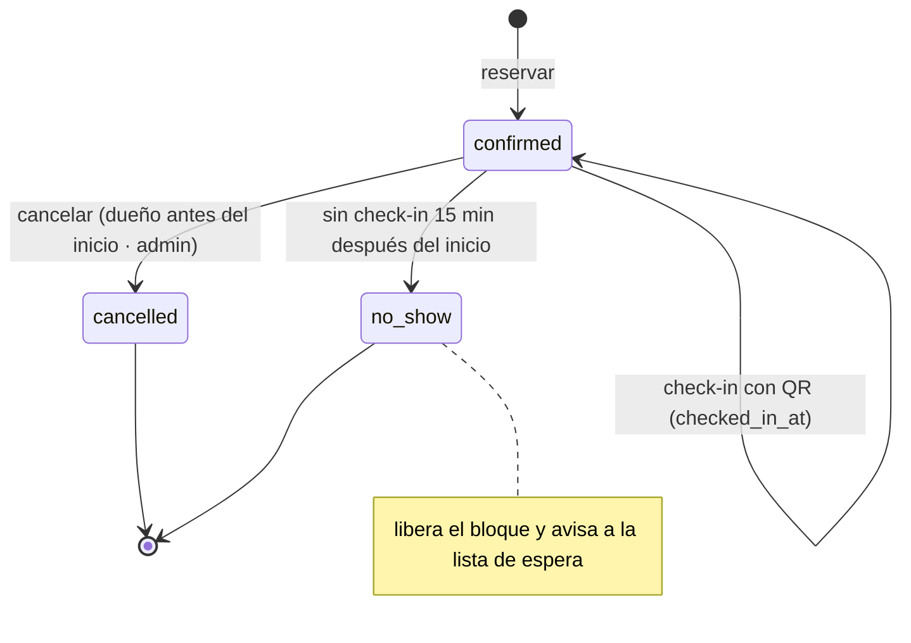
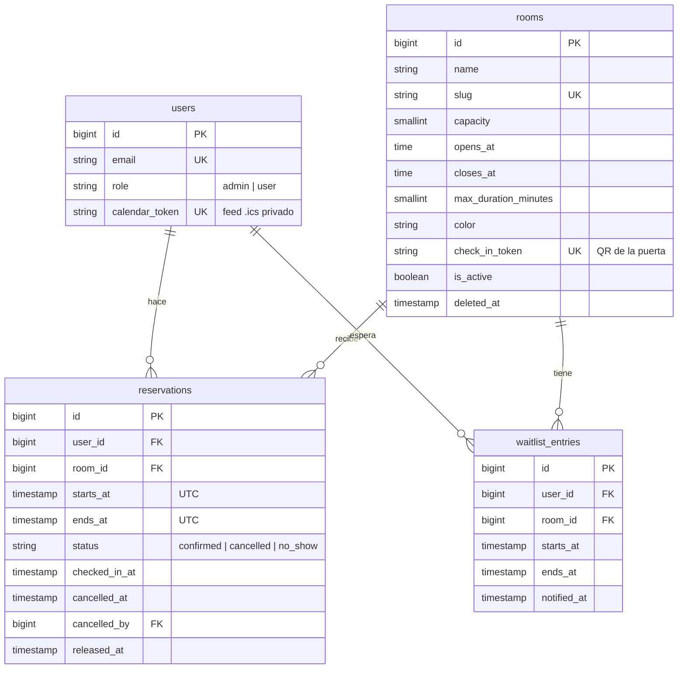

<p align="center">
  
</p>

<p align="center">
  Sistema de reservas de salas de estudio universitarias, con calendario, check-in por QR,
  liberación automática de inasistencias y lista de espera.<br>
  <strong>Laravel 13 · Livewire 4 · PostgreSQL 18 · Tailwind CSS 4</strong>
</p>

---

## Funcionalidades

**Para estudiantes**
- **Calendario** tipo Google Calendar: vista **semanal** por sala y vista **diaria** con todas las salas lado a lado, cada una con su color. Al hacer clic en un espacio libre, la reserva se abre con esa hora ya elegida.
- **Reservas en bloques de 30 minutos**, con duración máxima por sala, hasta 3 reservas activas por persona y hasta 14 días de anticipación.
- **Check-in con QR**: cada puerta tiene un QR con un token secreto de la sala. Al llegar, escaneas y confirmas tu asistencia.
- **Liberación automática**: si nadie hace check-in en los primeros 15 minutos, un job programado marca la reserva como *no asistió*, libera el bloque y avisa por correo.
- **Lista de espera**: en un bloque ocupado puedes pedir "avísame si se libera". Si se cancela o se libera, te llega un correo con un enlace directo para reservarlo.
- **Sincronización de calendario**: un feed iCal privado (`.ics`) para suscribirse desde Google Calendar, Outlook o Apple Calendar, con recordatorio 15 minutos antes. También se puede descargar el `.ics` de cada reserva.
- **Equipamiento y retiro**: indicación de equipamiento en sala (pantallas, proyector, wifi, enchufes) y elementos a retirar con la reserva (llaves, controles, adaptadores) con punto de entrega.
- **Correos** de confirmación, cancelación, liberación por inasistencia y bloque liberado.

**Para administradores**
- CRUD de salas con color, horario, capacidad, duración máxima, punto de retiro físico y equipamiento asignado, además de soft delete y activación/desactivación.
- **Afiche imprimible con el QR** de cada sala, y regeneración del token si el QR se filtra.
- Listado de todas las reservas con filtros; pueden cancelar cualquiera y el dueño recibe un aviso.
- Métricas: reservas de hoy, próximas reservas y **tasa de inasistencia** de los últimos 30 días.

## Conceptos de Laravel que muestra

| Área | Implementación |
|---|---|
| Autenticación | Starter kit oficial de Livewire: registro, login, recuperación de contraseña y verificación de correo |
| Eloquent | Relaciones, casts a Enums PHP (`Role`, `ReservationStatus`, `RoomColor`), scopes con `#[Scope]`, soft deletes y eventos de modelo |
| Migraciones | Esquema versionado en dos iteraciones, con restricción `EXCLUDE USING gist` y `CHECK` en PostgreSQL |
| Autorización | Gate `admin` + Policies (`RoomPolicy`, `ReservationPolicy`) con `Response::deny()` y `denyAsNotFound()` |
| Validación | Form Requests (`RoomRequest`, `StoreReservationRequest`) con hooks `after()` para las reglas de negocio y mensajes en español |
| Lógica de negocio | Acciones (`CreateReservation`, `CancelReservation`, `CheckIn`, `ReleaseNoShows`, `NotifyWaitlist`) con transacciones y bloqueo pesimista |
| Colas y scheduler | Notificaciones en cola (`ShouldQueue`, `afterCommit`); comando programado cada minuto con `withoutOverlapping()` |
| Livewire 4 | Componente de página completa (`Calendar`) y componente con estado en la URL (`#[Url]`, `#[Computed]`) para la disponibilidad |
| Integraciones | Feed iCalendar (RFC 5545) generado sin dependencias; QR en SVG con `chillerlan/php-qrcode` |
| Tests | 79 tests de feature con PHPUnit sobre PostgreSQL, con *data providers*, `travelTo`, `Notification::fake` y tests de Livewire |
| CI | GitHub Actions: tests contra PostgreSQL 18 + Pint |

## Cómo se evitan las reservas superpuestas

Dos intervalos semiabiertos `[inicio, fin)` se cruzan si **cada uno empieza antes de que termine el otro**. Así, 10:00–11:00 y 11:00–12:00 no chocan. La regla se aplica en tres capas:

1. **Form Request** (`StoreReservationRequest`): revisa la superposición y devuelve un mensaje claro al formulario.
2. **Acción con transacción** (`CreateReservation`): bloquea la fila de la sala con `SELECT … FOR UPDATE` y vuelve a comprobar. Así, dos peticiones simultáneas se procesan una después de la otra.
3. **Base de datos**: PostgreSQL rechaza cualquier superposición, venga de donde venga:

   ```sql
   ALTER TABLE reservations ADD CONSTRAINT reservations_no_overlap
     EXCLUDE USING gist (room_id WITH =, tsrange(starts_at, ends_at, '[)') WITH &&)
     WHERE (status = 'confirmed');
   ```

   Las reservas canceladas o liberadas por inasistencia quedan fuera de la restricción, así que el bloque vuelve a estar disponible. Si la base de datos rechaza la inserción (`SQLSTATE 23P01`), la aplicación la traduce al mismo mensaje de "horario ocupado".

## Ciclo de vida de una reserva



## Modelo de datos



Las fechas se guardan en **UTC** y se muestran en `APP_DISPLAY_TIMEZONE` (por defecto `America/Santiago`).

## Instalación local

**Requisitos:** PHP 8.4+ con `pdo_pgsql`, Composer, Node 22+ y PostgreSQL 15+.

```bash
git clone https://github.com/Faundezz21/Vortex-Booking.git
cd Vortex-Booking
composer install
npm install && npm run build
cp .env.example .env
php artisan key:generate
```

Crea las bases de datos (`.env.example` ya apunta a `vortex_booking` en `127.0.0.1:5432` con el usuario `postgres`):

```bash
psql -U postgres -c "CREATE DATABASE vortex_booking;"
psql -U postgres -c "CREATE DATABASE vortex_booking_test;"
```

Migra, carga los datos de demostración y levanta los procesos:

```bash
php artisan migrate --seed
php artisan serve
php artisan queue:work      # envía los correos
php artisan schedule:work   # libera inasistencias cada minuto
```

### Cuentas de demostración

| Rol | Correo | Contraseña |
|---|---|---|
| Administrador | `admin@vortexbooking.test` | `password` |
| Usuario | `usuario@vortexbooking.test` | `password` |

El seeder crea 7 salas (una inactiva), 62 usuarios, reservas entre 3 días atrás y 10 días adelante (con check-ins e inasistencias en el historial) y algunas personas en lista de espera. Siempre respeta las reglas del sistema.

Para probar el check-in sin imprimir nada: entra como administrador, abre **Gestionar salas → QR de check-in** y escanea el código con tu celular. También puedes abrir el enlace del QR estando en la ventana de tu reserva.

### Correo en desarrollo

`.env.example` apunta a un servidor SMTP local en el puerto `1025`: **Mailpit** (incluido en Laragon, en `http://localhost:8025`) o **Mailtrap** (reemplaza host, puerto y credenciales por los de tu *sandbox*).

## Tests

```bash
DB_CONNECTION=pgsql DB_DATABASE=vortex_booking_test php artisan test
```

Sin esas variables, los tests corren en SQLite en memoria y se salta el que verifica la restricción `EXCLUDE`.

| Archivo | Qué cubre |
|---|---|
| `Reservations/OverlapPreventionTest` | 7 formas de superposición rechazadas, reservas contiguas permitidas, condición de carrera y rechazo directo en PostgreSQL (`23P01`) |
| `Reservations/ReservationRulesTest` | Horario de la sala, duración máxima, bloques de 30 min, límite por persona, cancelación y permisos |
| `Reservations/CheckInAndNoShowTest` | Ventana de check-in, QR inválido o reemplazado, liberación a los 15 min, aviso a la lista de espera y reutilización del bloque liberado |
| `CalendarTest` | Vistas semana y día, privacidad de nombres, enlaces a bloques libres, feed `.ics` y regeneración del token |
| `AmenitiesTest` | Equipamiento instalado, elementos que se retiran con la reserva y validación de punto de retiro |
| `Admin/RoomManagementTest` | CRUD, validación, soft delete y que el registro público nunca cree administradores |

## Despliegue (Railway o Render)

El repositorio incluye un `Dockerfile` basado en `serversideup/php` (Nginx + PHP-FPM en el puerto **8080**). Al arrancar, el contenedor:

1. ejecuta las migraciones y guarda las cachés de Laravel;
2. carga los datos de demostración si la base está vacía;
3. con `RUN_SCHEDULER=true`, inicia `schedule:work` en el mismo contenedor. Lo ideal es correrlo como un servicio aparte con ese mismo comando.

Variables de entorno:

```dotenv
APP_NAME="Vortex Booking"
APP_ENV=production
APP_DEBUG=false
APP_KEY=base64:...            # php artisan key:generate --show
APP_URL=https://tu-app.up.railway.app
APP_LOCALE=es
DB_CONNECTION=pgsql
DB_URL=${{Postgres.DATABASE_URL}}   # Railway; en Render usa la "Internal Database URL"
SESSION_DRIVER=database
CACHE_STORE=database
QUEUE_CONNECTION=sync         # sin worker aparte en el plan gratuito
RUN_SCHEDULER=true
LOG_CHANNEL=stderr
MAIL_MAILER=smtp              # credenciales de Mailtrap
MAIL_HOST=sandbox.smtp.mailtrap.io
MAIL_PORT=2525
MAIL_USERNAME=...
MAIL_PASSWORD=...
MAIL_FROM_ADDRESS=reservas@vortexbooking.test
DEMO_RESEED_ON_BOOT=true      # opcional: datos de demostración frescos en cada despliegue
```

## Estructura relevante

```
app/
├── Actions/Reservations/      CreateReservation, CancelReservation, CheckIn, ReleaseNoShows
├── Actions/Waitlist/          NotifyWaitlist
├── Enums/                     Role, ReservationStatus, RoomColor
├── Http/Controllers/          Reservas, salas, check-in, exportación .ics y Admin/
├── Http/Requests/             StoreReservationRequest, Admin/RoomRequest
├── Livewire/                  Calendar (semana/día), RoomAvailability (bloques + lista de espera)
├── Notifications/             Confirmada, cancelada, liberada, bloque disponible
├── Policies/                  RoomPolicy, ReservationPolicy
└── Support/                   RoomSchedule, IcsCalendar
config/booking.php             bloques, límites, ventana de check-in y plazo de gracia
routes/console.php             comando reservations:release-no-shows y su programación
```

## Licencia

MIT.
